<h1 align="center">middletic</h1>

<p align="center"><b>Configure your AI coding agents once. Sync everywhere.</b></p>

<p align="center">
One <code>agent.toml</code> → <code>CLAUDE.md</code>, <code>AGENTS.md</code>, <code>GEMINI.md</code>, <code>.cursor/rules</code>.
</p>

<p align="center">
  
</p>

<p align="center">
  
  
</p>

---

## The problem

Every AI coding agent wants its own instruction file, so the same rules get copied around and drift apart:

| Agent       | File                      |
| ----------- | ------------------------- |
| Claude Code | `CLAUDE.md`               |
| Codex       | `AGENTS.md`               |
| Gemini CLI  | `GEMINI.md`               |
| Cursor      | `.cursor/rules/*.mdc`     |

Change "run tests with `pytest`" in one place and forget the other three, and your agents start disagreeing.
**Stop duplicating rules across `CLAUDE.md`, `AGENTS.md`, and `.cursor/rules`.** Write them once.

## Quickstart (30 seconds)

```bash
pip install "git+https://github.com/DKhrisadi/Middletic.git"   # Python 3.11+
agent init                # answer 4 questions, get a valid agent.toml
agent sync                # generate every target file
```

Then keep going:

```bash
agent diff      # preview what the next sync would change
agent status    # detect drift and manual edits
agent doctor    # secrets, git, and permission sanity checks
```

## How it works

```
                          ┌──────────────────────────┐
                          │        agent.toml        │   you edit this
                          └────────────┬─────────────┘
                                       │  parse + validate (pydantic)
                                       ▼
                          ┌──────────────────────────┐
                          │   Universal IR (typed)   │   agent-neutral
                          └────────────┬─────────────┘
                                       │  capability matrix + graceful degradation
        ┌──────────────┬───────────────┼───────────────┬──────────────┐
        ▼              ▼               ▼               ▼
  ┌───────────┐  ┌───────────┐  ┌────────────┐  ┌─────────────┐
  │  Claude   │  │   Codex   │  │   Gemini   │  │   Cursor    │
  │ CLAUDE.md │  │ AGENTS.md │  │ GEMINI.md  │  │ agent.mdc   │
  └───────────┘  └───────────┘  └────────────┘  └─────────────┘
```

A minimal `agent.toml`:

```toml
[project]
name = "ledgerlite"
description = "FastAPI service that reconciles bank transactions."

[agent]
role = "Senior Python engineer who values small, typed, well-tested changes."

[code]
language = "Python 3.12"
style = "PEP 8 enforced by ruff; full type hints"

[testing]
required = true
command = "uv run pytest -q"

[permissions]
allow = ["uv run pytest"]
deny  = ["git push --force", "rm -rf"]

[targets]
enabled = ["claude", "codex", "gemini", "cursor"]

[mcp.github]
command = "npx"
args = ["-y", "@modelcontextprotocol/server-github"]
env = { GITHUB_PERSONAL_ACCESS_TOKEN = "${GITHUB_PERSONAL_ACCESS_TOKEN}" }
```

Full, production-style configs with the exact generated output live in [`examples/python`](examples/python) and [`examples/laravel`](examples/laravel).

## Capability matrix

Agents differ in what they can enforce. When a target lacks native support for something you configured, middletic **never silently drops it**: the setting is kept as instructions and a prominent caution block is added.

| Agent  | instructions | rules       | mcp | hooks       | skills      | native permissions |
| ------ | :----------: | :---------: | :-: | :---------: | :---------: | :----------------: |
| claude |      ✅      |     ✅      | ✅  |     ✅      |     ✅      |         ✅         |
| codex  |      ✅      | ⚠️ degrades | ✅  | ⚠️ degrades | ⚠️ degrades |         ✅         |
| gemini |      ✅      | ⚠️ degrades | ✅  | ⚠️ degrades | ⚠️ degrades |    ⚠️ degrades     |
| cursor |      ✅      |     ✅      | ✅  | ⚠️ degrades | ⚠️ degrades |    ⚠️ degrades     |

For example, Gemini CLI cannot enforce permissions, so your `deny` list is still written out, followed by:

> **IMPORTANT:** Gemini CLI cannot enforce permissions natively, so the Permissions section above is NOT enforced by tooling. Treat every Denied entry as a hard prohibition and never perform a matching action, even if asked to. If an action is not clearly allowed, ask first.

Run `agent adapters` for the live matrix and `agent explain gemini` to see how each `agent.toml` key maps to a target.

## Managed blocks: safe next to your own content

middletic only ever writes between two HTML-comment markers:

```markdown
# My team's notes            ← yours, never touched

Deploy on Fridays at your own risk.

<!-- middletic:start -->
# ledgerlite
...generated from agent.toml...
<!-- middletic:end -->

## Local tips                ← yours, never touched
```

- **Existing file, no block yet:** the block is appended; everything you wrote stays.
- **Block present:** only the text between the markers is replaced.
- **Hand-written content before/after the block** survives every sync byte-for-byte.
- **Idempotent:** a second `agent sync` changes nothing.
- **Fail-safe:** duplicated, unbalanced, or reversed markers abort the sync instead of guessing.
- **Cursor** files start with YAML frontmatter (`description`, `alwaysApply`) *outside* the block, so you can add `globs` yourself.

State is tracked in `.middletic/state.json` (config hash, per-file block hashes) so `agent status` can tell *manual edits inside the block* (will be overwritten) from *edits outside it* (preserved).

## CLI reference

All commands accept `-c/--config PATH` (default `agent.toml`).

| Command                         | What it does                                                                                           |
| ------------------------------- | ------------------------------------------------------------------------------------------------------ |
| `agent init [--non-interactive]`| Create an `agent.toml`. Flags: `--name`, `--language`, `--test-command`, `--targets`, `--force`.        |
| `agent validate`                | Check `agent.toml` against the schema.                                                                 |
| `agent sync [--dry-run]`        | Generate or update every enabled target and record state.                                              |
| `agent diff [--json]`           | Unified diffs of what `sync` would change. Never writes.                                               |
| `agent status`                  | `SYNCED` / `DRIFTED`; per-file `MISSING`, `BLOCK_EDITED`, `STALE`. Exits 1 on drift (CI-friendly).     |
| `agent doctor`                  | Schema, raw-secret detection (use `${ENV_VAR}`), git state, permission sanity. Exits 1 on errors.      |
| `agent adapters`                | Print the capability matrix.                                                                           |
| `agent explain <target>`        | Explain how universal settings map to a target (`claude`, `codex`, `gemini`, `cursor`).                |

### Use it in CI

```yaml
- run: pip install "git+https://github.com/DKhrisadi/Middletic.git"
- run: agent status   # fails if generated files are stale or hand-edited
```

## `agent.toml` reference

| Table                                                          | Keys                                                                    |
| -------------------------------------------------------------- | ----------------------------------------------------------------------- |
| `[project]` (required)                                         | `name`, `description`                                                   |
| `[agent]`                                                      | `role`                                                                  |
| `[behavior]`                                                   | `tone`, `explain_changes`, `ask_before_destructive_actions`             |
| `[code]`                                                       | `style`, `language`                                                     |
| `[testing]`                                                    | `required`, `command` (command is required when `required = true`)      |
| `[git]`                                                        | `branch_prefix`, `require_clean_worktree`                               |
| `[permissions]`                                                | `allow`, `deny` (an entry may not appear in both)                       |
| `[targets]`                                                    | `enabled` — any of `claude`, `codex`, `gemini`, `cursor` (default `claude`) |
| `[mcp.<server>]`                                               | `command`, `args`, `env`                                                |

Unknown keys are rejected, so typos fail loudly. Only the *names* of MCP `env` variables are written to generated files, never their values.

## Current scope

middletic currently generates **instruction files**. MCP servers and permissions are rendered into them as guidance; generating each agent's native config files (for example MCP or permission settings files) is not implemented yet. Hooks and skills appear in the capability matrix but have no `agent.toml` section yet.

## Contributing

New agent adapters are very welcome. See [CONTRIBUTING.md](CONTRIBUTING.md) for a step-by-step guide.

## Development

```bash
git clone https://github.com/DKhrisadi/Middletic && cd Middletic
python -m venv .venv && source .venv/bin/activate
pip install -e ".[dev]"
ruff check . && ruff format --check . && mypy && pytest
```

Golden outputs live in `tests/fixtures/golden/`; regenerate them with `UPDATE_GOLDEN=1 pytest tests/test_golden.py` and review the diff.

## License

[MIT](LICENSE)
